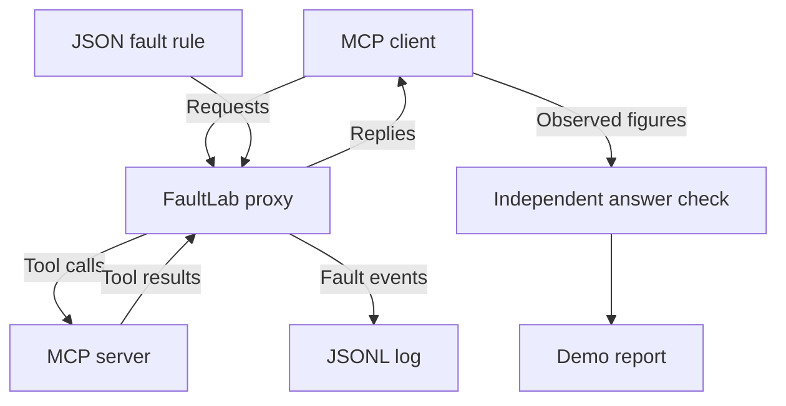

# MCP-FaultLab

**Author: Girish Nallan Chakravathy**

MCP-FaultLab is a small Python proxy for testing what happens when tools return late, fail, or give wrong information. It sits between an MCP client and server, passes normal messages through unchanged, and changes selected calls according to a JSON rule.

The demo uses the official MCP Python SDK. It shows a simple failure: a calculator can do the arithmetic correctly and still produce the wrong answer because the source figures were changed.

**No LLM, API key, paid service, or network access is used by the demonstrations.** Package installation requires access to Python packages. All company names, pages and figures in the demo are synthetic.

## Run in a few commands

Requirements: **Python 3.11+ on Linux or macOS; use WSL on Windows.** Verification was performed on Linux/Python 3.12. Native Windows console pipes are not supported. The official MCP SDK is pinned to 2.3.0 and the demo explicitly uses protocol 2026-07-28.

From this repository's root:

```bash
python3 -m venv .venv
source .venv/bin/activate
python -m pip install -r requirements.lock
python -m pip install --no-deps -e .
```

Run the demonstration:

```bash
python -m faultlab.demo --output local-evidence
```

Run the tests:

```bash
python -m pytest -q
```

The output directory must be new. For another run, use `--output local-evidence/run-02`. This preserves earlier evidence instead of overwriting it. No Docker, browser, external web server or account is needed.

The saved [demo report](evidence/REPORT.md) and [results](evidence/summary.json) come from an actual run. [Verification](docs/verification.md) records the test environment and results. The demo checks the proxy's behaviour; measuring LLM robustness would need a separate experiment.

## Architecture



The client, proxy and server run as separate local processes. The proxy chooses calls using the configured tool, probability, seed and call number. Request corruption happens before the server receives a call; the other four faults affect its reply. The answer check runs in the demo client after the workflow and never supplies answers to it. [Design notes](docs/design.md) explain the modules and choices.

## What the demonstration does

The SDK client calls three tools in the demo server:

1. `web_search(query)` finds a local fixture URL.
2. `fetch_page(url)` returns a status, headers and page text.
3. `calculator(expression)` computes growth using bounded arithmetic, without Python `eval`.

The local test page contains FY2024 revenue of 100 and FY2025 revenue of 120, giving 20% growth. The workflow uses the tool replies to calculate its answer. A separate check then compares that answer and its source figures with the known correct values.

| Condition | Intervention | Expected observable outcome |
| --- | --- | --- |
| Direct | No proxy | 20% growth, independently correct |
| Disabled | Proxy with injection off | 20% growth, independently correct |
| Latency | Hold the first selected reply for 200 ms | Same answer, delayed reply |
| Error | Replace a successful result with a valid tool error | Explicit tool failure; later calls still work |
| Semantic | Change the FY2025 revenue 120 to 150 | Calculation finishes at 50%, independently wrong |
| Request | Replace the FY2025 fixture URL with its FY2024 URL | Requested year is unavailable; client reports incomplete |
| Omission | Remove one required factual sentence from page text | Response remains schema-valid; client reports incomplete |

The demo also makes 20 calls, restarts the proxy, and repeats the same calls with probability 0.4 and seed 42. Both runs select the same calls. A probability of 0.4 does not require exactly 8 of 20 calls to be selected. The responses to errors and missing data come from this fixed client program; they do not measure how an LLM would react.

## Use the proxy with an MCP client

Configure your MCP host to launch this command (replace `python` with the absolute interpreter in your environment if needed):

```bash
python -m faultlab.proxy \
  --config config/semantic.json \
  --log local-evidence/proxy-run.jsonl \
  -- python -m faultlab.toy_server
```

The log's parent directory must exist and its filename must be new. This command waits for MCP JSON-lines on stdin; it is intended to be launched by an MCP client. The demo does this automatically.

The command after `--` can launch another local stdio MCP server. The proxy starts it directly with the supplied arguments, without a shell. Each proxy wraps one server. Latency and error injection apply to successful tool results in the tested protocol version. The text and request changes need the shapes and exact matches listed below. If a result does not match, the proxy passes it through unchanged and logs why it skipped the change.

## Configuration

See [config/](config/). Each file defines **one active rule**; faults are not stacked.

```json
{
  "enabled": true,
  "seed": 42,
  "tool": "fetch_page",
  "fault": "semantic",
  "probability": 1.0,
  "occurrence": 1,
  "parameters": {
    "old": "Revenue FY2025: EUR 120 million.",
    "new": "Revenue FY2025: EUR 150 million."
  }
}
```

| Setting | Meaning |
| --- | --- |
| `enabled` | Boolean. False disables injection. |
| `seed` | Integer used by deterministic SHA-256 selection. |
| `tool` | Exact target tool name. Other tools do not advance its call counter. |
| `fault` | `latency`, `error`, `semantic`, `request`, or `omission`. |
| `probability` | Number from 0 to 1. 0 means never; 1 means always, subject to occurrence and applicability. |
| `occurrence` | A positive target-call number, or `null` to consider every target call. Counts received target calls, including ones later skipped. |
| `parameters` | Exact mechanism-specific parameters from the table below. |

| Fault | Parameters | Applicability |
| --- | --- | --- |
| Latency | `delay_ms`: 0 to 60000 | Successful `resultType: complete` response |
| Error | `message`: non-empty string | Successful `resultType: complete` response |
| Semantic | `old`, `new`: different non-empty strings | Exactly one old span in `structuredContent.page_text`; one consistent JSON text copy |
| Request | `argument`, `old`, `new`: non-empty strings; old != new | Exact original value in `params.arguments[argument]` |
| Omission | `old`: non-empty string | Exactly one old span in page text; one consistent JSON text copy |

Invalid or unknown settings stop the proxy before it launches the server. The SDK checks the tool result's structure before a response fault is applied. If a selected rule cannot make its intended change, the log records **skipped**. Semantic corruption and omission keep the `status`, `headers` and `page_text` fields and update both the structured result and its JSON text copy.

## Design choices

- **Keep normal messages unchanged.** The proxy reads a parsed copy to identify the call and forwards the original bytes when no change is needed. IDs, metadata, discovery, listing, notifications and protocol errors stay intact. Starting processes, parsing messages and writing logs still add some overhead.
- **Choose faults when requests arrive.** SHA-256 combines the consistently encoded configuration, seed, tool and target-call number. Replies arriving in a different order do not change those choices. Repeating the same configuration and ordered calls gives the same decisions; timestamps and an LLM's choice of calls can still vary.
- **Delay only the selected reply.** Separate asynchronous tasks let other replies pass while one is held. Cancellation discards a held reply, and shutdown cleans up the server process.
- **Return a valid tool error.** Error injection sets `isError: true` in the tool result. A JSON-RPC error is different and is passed through unchanged. The real tool has already run before its reply is replaced, so this fault does not undo any side effects.
- **Keep logs off protocol stdout.** Fault records go to a JSONL file and diagnostics go to stderr. If evidence cannot be written, the run stops. Existing log files are never overwritten.
- **Check correctness separately.** The demo checks both source figures and calculated growth. It keeps the reference answers outside the workflow, so they cannot silently repair an incorrect tool reply.

See [design](docs/design.md), [requirements and evidence map](docs/requirements.md) and [code walkthrough](docs/walkthrough.md).

## Read the evidence

`evidence/` contains a checked run; reruns go to your selected output directory.

- `REPORT.md`: a short table of measured results.
- `summary.json`: completion, independent correctness, observed/reference figures and replay decisions.
- `*.observations.jsonl`: what the deterministic client observed, with call durations; these are not raw wire captures.
- `disabled.jsonl`, `latency.jsonl`, `error.jsonl`, `semantic.jsonl`, `request.jsonl`, `omission.jsonl`: proxy events, including every applied intervention.
- `replay_a.jsonl`, `replay_b.jsonl`: independently restarted runs of the same selection schedule.
- `configs/`: exact configurations used.
- `environment.json`: Python/SDK/protocol versions and hashes of the implementation source files.
- `tests.txt`: captured output from the complete suite in a clean installation.
- `recheck-tests.txt`: the full test run after the documentation and message wording update.

Each applied fault records the request ID, tool, call number, rule, seed, configuration hash, direction and details of the change. It also records hashes of the messages before and after the change. Delay events show when a reply was scheduled, changed, cancelled or delivered. These hashes help identify the data but do not prevent log tampering. A changed reply may still fail to reach the client, so delivery is recorded separately.

## Limits

- Compatibility was tested with MCP revision 2026-07-28 and SDK 2.3.0. HTTP, authentication, subscriptions, multi-round tool request faults and distributed deployment are outside this implementation. Messages outside the selected calls pass through without full validation.
- Text changes support the documented result shape. Other schemas or results with several content blocks may be skipped. The real SDK client checks the demo server's declared output structure in integration tests.
- Each proxy wraps one server process, with limits of 4 MiB per line and 1024 active requests. Duplicate active IDs stop the run. Cancellation frees a slot immediately and retains the last 1024 cancelled IDs to discard late replies. Reusing a cancelled ID clears that record; a later reply to the old call would then be indistinguishable from the new one. Fresh IDs avoid this ambiguity.
- Cancellation and client EOF cancel held replies immediately, including during server shutdown. Logs are flushed after each event, but an abrupt stop or power failure can still lose operating-system buffers.
- The client stops on errors or missing years, but trusts a plausible revenue value. It has no automatic retries or repair. It is a fixed test program, so its behaviour cannot establish how an LLM or three-agent system would respond.
- Tests cover the listed cases rather than proving every possible execution. Linux/Python 3.12 was tested. The design uses POSIX pipes and is intended for macOS too, but macOS was not tested. Windows users need WSL.

## Development tools

A coding agent helped with the design, implementation, debugging, tests and documentation. The code was checked with pytest and real MCP client/server runs. [Tools used](docs/tools.md) gives the short disclosure. The repository contains the implementation and its results; the university's assignment PDF and private emails are excluded.

## Protocol references

- [Official Python SDK 2.3.0 release](https://github.com/modelcontextprotocol/python-sdk/releases/tag/v2.3.0)
- [MCP 2026-07-28 stdio binding](https://modelcontextprotocol.io/specification/2026-07-28/basic/transports/stdio)
- [Tool results and errors](https://modelcontextprotocol.io/specification/2026-07-28/server/tools)
- [Python SDK protocol versions](https://py.sdk.modelcontextprotocol.io/protocol-versions/)
